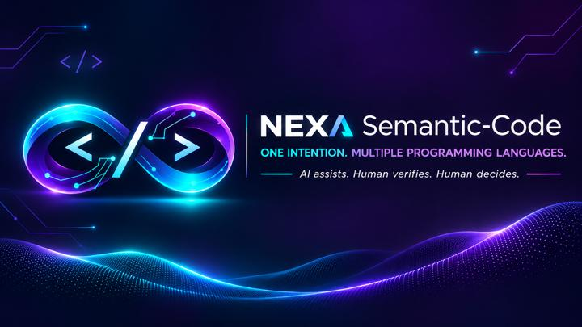

  

# NEXA Semantic-Code ♾️
**ONE INTENTION. MULTIPLE PROGRAMMING LANGUAGES.**

NEXA-SLM is the repository and proposed local semantic intelligence engine for NEXA Semantic-Code, part of NextGenAI Infinity.

**Status: Project Foundation v0.1.0 — architecture and draft contracts, not yet runnable.**

Human intent → keywords → semantic interpretation → typed IR → compatibility → language adapters → validation → token-level explanations.

See [architecture](docs/architecture/ARCHITECTURE.md), [mandatory UX requirements](docs/ux/REQUIREMENTS.md), [security](docs/security/THREAT_MODEL.md) and [roadmap](docs/development/ROADMAP.md).

No external AI API required by design. Local model selection and packaging are pending. Never invent unsupported equivalents or execute generated code automatically.

*AI assists. Human verifies. Human decides.*

**THERE IS NO FINAL VERSION. THERE IS ONLY EVOLUTION.**
