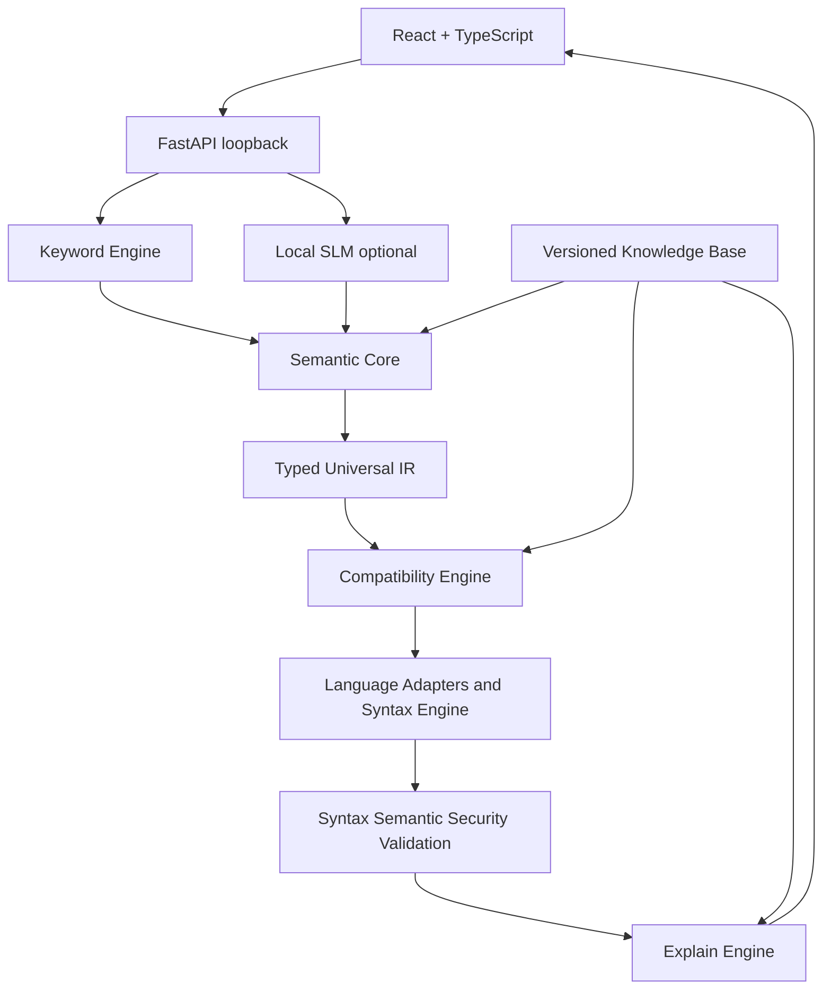

# NEXA Semantic-Code / NEXA-SLM
Status: foundation, not a working implementation.

Modular Python monolith; optional llama.cpp production runtime, Ollama research provider, deterministic fallback. Local retrieval, schema-constrained output, no cloud dependency. SQLite history opt-in; PostgreSQL and Alembic later. Rust adapters optional. Model selection is pending benchmarks; no weights included. No generated code executed automatically. Validation must expose separate syntax, behavior and security statuses, including NOT_RUN. Unknown intent or compatibility must abstain. Ambiguous intent must request clarification or present explicitly labeled alternatives.
