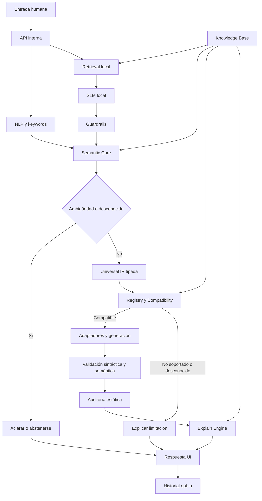

# Flujo de datos

La inferencia no tiene acceso a shell ni red obligatoria. La base de conocimiento aporta evidencia, no instrucciones ejecutables. El motor determinista puede resolver sin SLM. Cada etapa conserva identificador de petición, versión de catálogo/modelo y estado de error; historial no guarda datos por defecto. Las comparaciones mantienen alcance y dependencias por tecnología.
